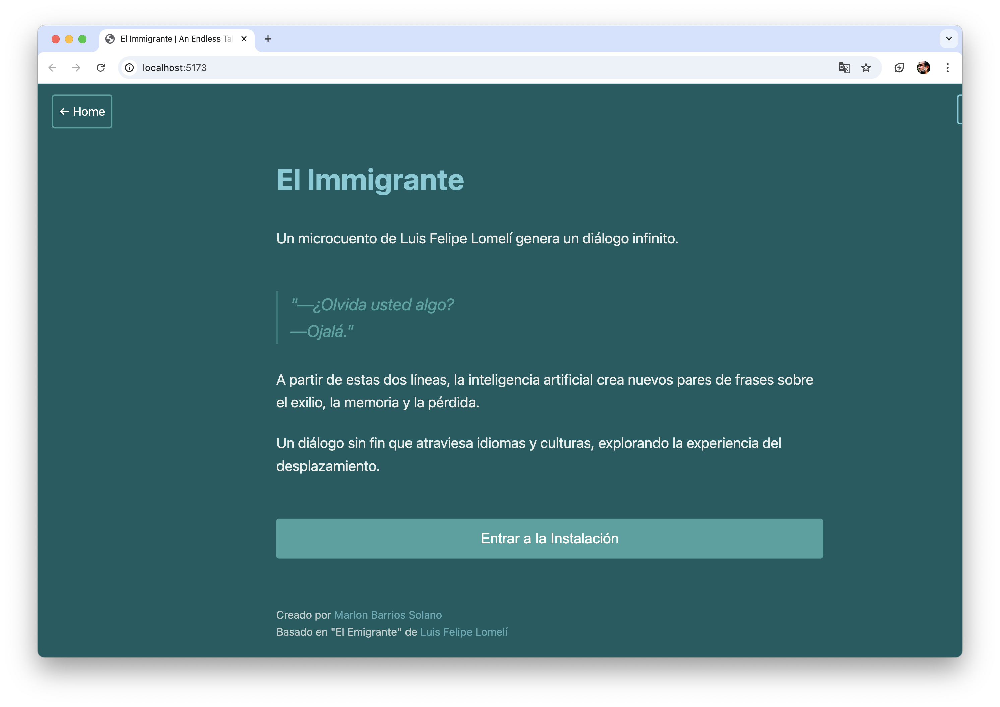
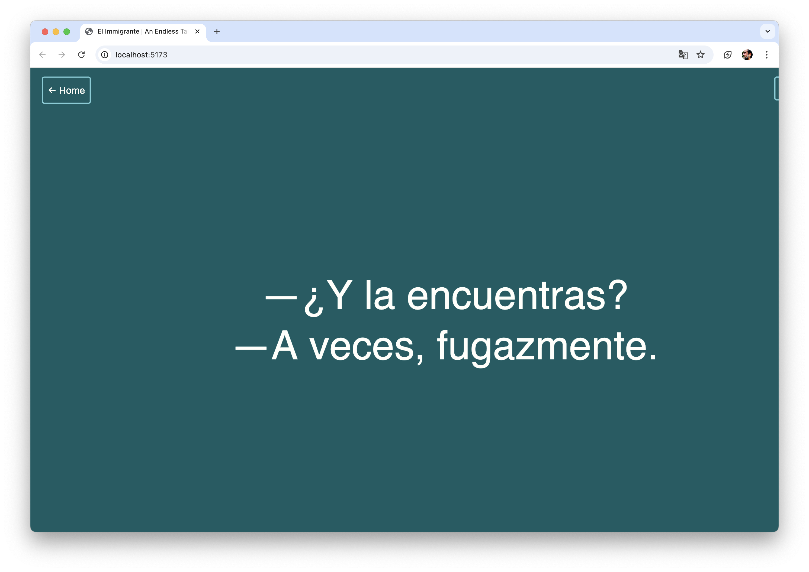

# El Inmigrante | An Endless Tale of Memory and Loss

A local-AI art installation. Short dialogues about longing appear, fade, and are replaced, like memories that will not stay gone. Nothing is sent to a cloud model. The text is written on this machine by **Qwen 3.5 27B** through [Ollama](https://ollama.com).





## About

**El Inmigrante** comes from the microstory "El Emigrante" by Luis Felipe Lomelí. The whole story is two lines:

—¿Olvida usted algo?
—Ojalá.

In English: "Forget something?" / "If only." The answer means *I wish I could forget.* The person wants to forget and, at the same time, cannot stop remembering. That contradiction is the longing.

The installation keeps writing new pairs in that spirit. Each pair is two spoken lines, usually two to four words, each opening with an em dash. The image changes — a name, a house, a voice, papers, the country left behind — but the feeling stays: forgetting is wished for, and memory makes the missing worse.

A spiral plays between pairs. It stands in for time passing.

## How it works

1. The landing page offers the piece in many languages. Entering stores the chosen language and opens the p5.js canvas.
2. A spiral plays for about two seconds. Then the sketch asks Ollama whether the model is available.
3. The browser does not call Ollama directly. Vite forwards `/ollama` to `http://127.0.0.1:11434`, so the page stays on localhost and the model never leaves the machine.
4. Each turn is one chat request to `qwen3.5:27b`. Thinking is turned off, so the model answers with the two lines instead of a long chain of thought.
5. The prompt holds the paradox, asks for plain grammatical speech, and names one concrete thing for this turn. Recent lines are sent back with the request so the next pair does not repeat them.
6. The reply is parsed down to two dialogue lines. A count in the bottom-right corner goes up by one and is kept in the browser, so the next visit continues the tally.
7. The lines fade in, hold, and fade out. Then the spiral returns and another pair is requested.

The default model tag is `qwen3.5:27b` (about 17 GB). Another local model can be selected with `VITE_OLLAMA_MODEL` without changing the piece.

## Model

| | |
|---|---|
| Runtime | Ollama, on this computer |
| Model | `qwen3.5:27b` |
| Family | Qwen 3.5, 27 billion parameters |
| Request | `POST /api/chat`, non-streaming, thinking disabled |
| Output | Two short lines in the selected language |

The first line after a restart is slower, because Ollama has to load the weights into memory. Later lines are quicker while the model stays loaded.

## Setup

### Prerequisites

- Node.js 18 or newer
- [Ollama](https://ollama.com) running on this machine
- The model `qwen3.5:27b`

### Run

```bash
npm install
ollama pull qwen3.5:27b
npm run dev
```

Open `http://localhost:5173`. Skip the pull if `ollama list` already shows `qwen3.5:27b`.

To use a different installed model, add a `.env` file and restart the dev server:

```env
VITE_OLLAMA_MODEL=qwen3.5:27b
```

A production build is `npm run build`, then `npm run preview`. The preview server uses the same Ollama proxy.

## Controls

- **Language menu**: the prompt language for the next pair
- **Space**: write a new pair now
- **P**: performance mode. Music on, black background, and a cycle through every language that returns to Spanish between each one
- **D**: the same pace and music, but only Spanish and English
- **Home**: back to the landing page

## Languages

The landing page and the prompts cover more than twenty languages, including Spanish, English, French, German, Italian, Portuguese, Russian, Ukrainian, Greek, Turkish, Polish, Dutch, Swedish, Czech, Japanese, Chinese, Korean, Hindi, Thai, Vietnamese, Arabic, Kiswahili, Yoruba, Amharic, and isiZulu.

Spanish is the home language of the seed text. The other prompts ask for the same paradox in that language: wanting to forget, and remembering anyway.

## Timing

These values are in `sketch.js`:

```javascript
const GENERATION_CYCLE = 10000; // milliseconds before the next request
const FADE_IN_TIME = 2800;
const DISPLAY_TIME = 600;
const FADE_OUT_TIME = 3200;
```

The colors live in the `COLORS` object. The voice of each language lives in `LANGUAGES`.

## Troubleshooting

**"Ollama is not running"**
Start the Ollama app, or run `ollama serve`. Use `npm run dev` so `/ollama` can reach `http://127.0.0.1:11434`.

**"Qwen 3.5 is not in Ollama"**
Run `ollama pull qwen3.5:27b`, or set `VITE_OLLAMA_MODEL` to a tag already in `ollama list`, then restart the dev server.

**No text, or a long pause**
The first request loads about 17 GB into memory. Check the browser console if a later request fails.

## License

This project is an art installation. Please respect the artistic intent and contact the creator for any commercial use or significant modifications.

## Artist statement

*El Inmigrante* comes from thinking about memory and displacement in a digital age. The machine does not answer the question of the microstory. It keeps asking it, in other words, in other languages, and then lets the words fade.

The spiral is time: a memory forming, becoming readable, and dissolving.

---

*Created for those who carry memories across borders, both physical and digital.*
